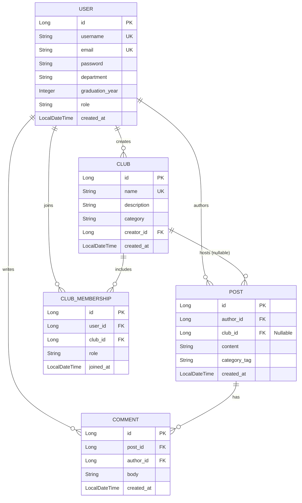

# campoSocial — System Specification & Project Phases

## 1. Executive Summary & Product Vision

`campoSocial` is an all-in-one university campus social platform designed for students to connect, share inside jokes, engage in campus discussions, follow student-led clubs, and communicate.

The software is engineered as a monolithic Spring Boot web application using server-side rendered HTML5/CSS3 (Thymeleaf), backed by Spring Security with session-based cookie authentication (`JSESSIONID`) and Spring Data JPA.

---

## 2. Technical Stack & Architectural Constraints

| Layer | Technology & Standards |
| :--- | :--- |
| **Backend** | Java 17+, Spring Boot 3.x / 4.x (`spring-boot-starter-web`, `spring-boot-starter-security`, `spring-boot-starter-data-jpa`, `spring-boot-starter-validation`, `spring-boot-starter-thymeleaf`) |
| **Frontend** | Server-Side Rendered (SSR) HTML5, Vanilla CSS3 (Custom Design System, no external CSS bloatware), Thymeleaf Standard Dialect |
| **Security** | Standard Spring Security Form Login, Session Cookie Management (`JSESSIONID`), `BCryptPasswordEncoder`, CSRF token integration across all POST forms. **Strictly NO JWT/token-based APIs.** |
| **Persistence (Dev)** | In-memory H2 Database (`jdbc:h2:mem:campodb`) with H2 Console enabled (`/h2-console`) |
| **Persistence (Prod)** | MySQL / PostgreSQL dialect abstraction via Spring Data JPA |
| **Build Tool** | Maven (`mvnw`) |

### Architectural Principles
1. **Stateful Session Security:** Every authenticated student session is tracked via standard HTTP-only `JSESSIONID` cookies managed by the servlet container and Spring Security's `SecurityContextHolder`.
2. **Server-Side Rendering (SSR):** Controllers return Thymeleaf view names populated via Spring `Model` attributes. All state-mutating `POST` forms automatically embed Spring Security `_csrf` tokens via `th:action`.
3. **Layered Package Structure:**
   - `org.benjamincharles.camposocial.config` — Security, web, and seeding configurations
   - `org.benjamincharles.camposocial.controller` — MVC controllers and route handlers
   - `org.benjamincharles.camposocial.entity` — JPA domain entities
   - `org.benjamincharles.camposocial.repository` — Spring Data JPA repositories
   - `org.benjamincharles.camposocial.service` — Business logic and transactional services

---

## 3. Core Functional Requirements

### 3.1 Identity, Access & Verification
- **FR-AUTH-01:** University email verification during sign-up (e.g., student domain validation).
- **FR-AUTH-02:** User registration with unique username, email, and BCrypt-hashed password.
- **FR-AUTH-03:** Standard session-based login with persistent user authentication across requests.
- **FR-AUTH-04:** Logout endpoint invalidating the current HTTP session and clearing the security context.
- **FR-AUTH-05:** Role-based access control (`ROLE_USER`, `ROLE_CLUB_ADMIN`, `ROLE_CAMPUS_ADMIN`).

### 3.2 Campus Feed & Community Interaction
- **FR-FEED-01:** Multi-category posting system (e.g., `#InsideJoke`, `#Announcement`, `#GeneralDiscussion`, `#Academic`).
- **FR-FEED-02:** Public campus timeline displaying recent posts sorted chronologically or by engagement.
- **FR-FEED-03:** Post engagement: "Agrees" (upvotes) and threaded comments under each post.
- **FR-FEED-04:** Post moderation: Authors can delete their own posts; admins can remove flagged content.

### 3.3 Student Clubs & Communities
- **FR-CLUB-01:** Directory of student clubs categorized by interest (`Tech`, `Arts`, `Sports`, `Academic`).
- **FR-CLUB-02:** Club membership lifecycle: Join, Leave, and View Members.
- **FR-CLUB-03:** Club-specific broadcast feed visible to campus or club members.
- **FR-CLUB-04:** Club administration: Club leaders can manage members and pin announcements.

### 3.4 Direct Messaging & Student Connections (Next Iteration)
- **FR-CHAT-01:** Student-to-student direct conversations.
- **FR-CHAT-02:** Conversation inbox showing active message threads.

---

## 4. Entity-Relationship Data Model

### 4.1 Schema Overview

### 4.2 Entity Definitions & JPA Relationships

1. **`User` (`users`)**
   - **Fields:** `id` (`Long`, PK), `username` (`String`, unique, non-null), `email` (`String`, unique, non-null), `password` (`String`, BCrypt hash, non-null), `department` (`String`), `graduation_year` (`Integer`), `role` (`String`, default `"ROLE_USER"`), `created_at` (`LocalDateTime`).
   - **Relationships:**
     - `@OneToMany(mappedBy = "author")` -> `Post`
     - `@OneToMany(mappedBy = "author")` -> `Comment`
     - `@OneToMany(mappedBy = "user")` -> `ClubMembership`

2. **`Post` (`posts`)**
   - **Fields:** `id` (`Long`, PK), `author_id` (`FK -> User`, `@ManyToOne(optional = false)`), `club_id` (`FK -> Club`, `@ManyToOne(optional = true)`), `content` (`String`, `@Column(columnDefinition = "TEXT")`), `category_tag` (`String`), `created_at` (`LocalDateTime`).
   - **Relationships:**
     - `@OneToMany(mappedBy = "post", cascade = CascadeType.ALL, orphanRemoval = true)` -> `Comment`

3. **`Comment` (`comments`)**
   - **Fields:** `id` (`Long`, PK), `post_id` (`FK -> Post`, `@ManyToOne(optional = false)`), `author_id` (`FK -> User`, `@ManyToOne(optional = false)`), `body` (`String`, non-null), `created_at` (`LocalDateTime`).

4. **`Club` (`clubs`)**
   - **Fields:** `id` (`Long`, PK), `name` (`String`, unique, non-null), `description` (`String`), `category` (`String`), `creator_id` (`FK -> User`, `@ManyToOne(optional = false)`), `created_at` (`LocalDateTime`).
   - **Relationships:**
     - `@OneToMany(mappedBy = "club", cascade = CascadeType.ALL)` -> `ClubMembership`
     - `@OneToMany(mappedBy = "club")` -> `Post`

5. **`ClubMembership` (`club_memberships`)**
   - **Fields:** `id` (`Long`, PK), `user_id` (`FK -> User`, `@ManyToOne(optional = false)`), `club_id` (`FK -> Club`, `@ManyToOne(optional = false)`), `role` (`String`, e.g., `"MEMBER"`, `"LEADER"`), `joined_at` (`LocalDateTime`).
   - **Constraints:** Unique composite constraint on `(user_id, club_id)`.

---

## 5. Phased Implementation Roadmap

### Phase 1: Authentication & Core Scaffolding (Completed / Active Baseline)
- [x] Clean up `pom.xml`, removing leftover JWT and unneeded OAuth2/SAML dependencies.
- [x] Configure `application.properties` with H2 database and JPA settings.
- [x] Implement `User` entity, `UserRepository`, and `PasswordEncoder` configuration.
- [x] Set up `SecurityConfig` with form-based login, logout, and protected route handlers.
- [x] Create `AuthController` and render `login.html` and `signup.html` matching the design system.
- [x] Build initial authenticated landing page (`/feed`) to verify successful session creation.

### Phase 2: Campus Feed & Interaction Engine
- [ ] Implement `Post`, `Comment`, and `Reaction` JPA entities and repositories.
- [ ] Build `PostService` handling creation, fetching with pagination, and agree/upvote counting.
- [ ] Develop `FeedController` and build the full 3-column `feed.html` template.
- [ ] Implement CSRF-protected form handling for creating new posts and submitting comments.

### Phase 3: Student Clubs & Directory
- [ ] Implement `Club` and `ClubMembership` entities, repositories, and services.
- [ ] Develop `ClubController` to serve the club directory (`/clubs`) and club profile pages (`/clubs/{id}`).
- [ ] Implement member join/leave actions and club-specific post filtering.
- [ ] Populate initial campus clubs (Tech Society, Arts & Media, Sports Hub).

### Phase 4: Direct Messaging & Chat
- [ ] Design conversation and message storage model.
- [ ] Implement basic messaging controller and UI views.
- [ ] Optional enhancement: Add WebSocket (`spring-boot-starter-websocket`) for real-time live messaging.

### Phase 5: Production Hardening & Deployment
- [ ] Replace H2 with MySQL/PostgreSQL configuration.
- [ ] Implement Flyway database schema migration scripts.
- [ ] Audit input sanitization and enforce rate limiting on auth endpoints.
- [ ] Package application as an executable JAR container.

